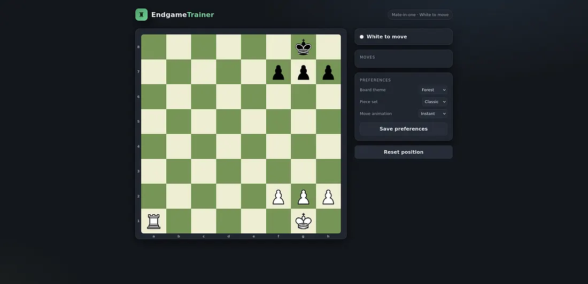
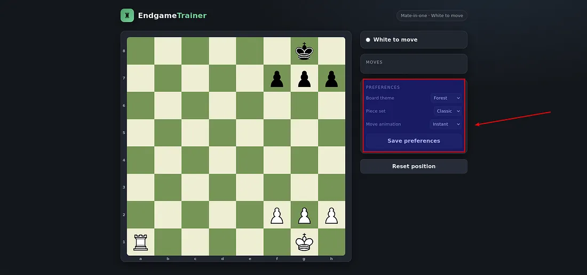
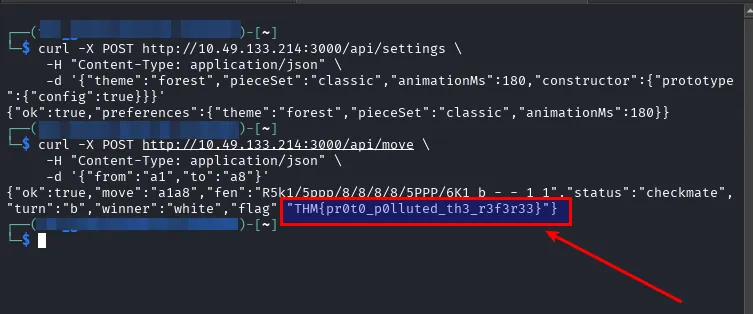
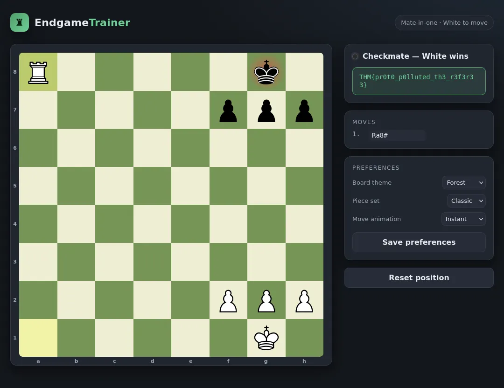

<div class="ctf-hero">

  <h1>Fool's Mate, Revenge</h1>

  <p>
    A TryHackMe web security assessment examining how prototype pollution in a Node.js chess application can influence inherited configuration state and bypass a server-side reward gate.
  </p>

  <div class="ctf-badges">
    <span class="ctf-badge">TryHackMe</span>
    <span class="ctf-badge">Advanced</span>
    <span class="ctf-badge">Web Security</span>
    <span class="ctf-badge">Node.js</span>
    <span class="ctf-badge">Prototype Pollution</span>
  </div>

</div>


## Navigation

<div class="ctf-toc">
  <div class="ctf-toc-title">Documentation Map</div>
  <ul>
    <li><a href="#mission-and-overview">Mission and Overview</a></li>
    <li><a href="#quick-overview">Quick Overview</a></li>
    <li><a href="#target-and-application-context">Target and Application Context</a></li>
    <li><a href="#attack-chain">Attack Chain</a></li>
    <li><a href="#endgame-analysis">Endgame Analysis</a></li>
    <li><a href="#server-side-authorization-gate">Server-Side Authorization Gate</a></li>
    <li><a href="#preferences-attack-surface">Preferences Attack Surface</a></li>
    <li><a href="#prototype-pollution-analysis">Prototype Pollution Analysis</a></li>
    <li><a href="#authorization-bypass-and-reward-unlock">Authorization Bypass and Reward Unlock</a></li>
    <li><a href="#core-security-finding">Core Security Finding</a></li>
    <li><a href="#challenge-flag">Challenge Flag</a></li>
    <li><a href="#security-recommendations">Security Recommendations</a></li>
    <li><a href="#full-technical-walkthrough">Full Technical Walkthrough</a></li>
    <li><a href="#repository">Repository</a></li>
    <li><a href="#responsible-use">Responsible Use</a></li>
    <li><a href="#author">Author</a></li>
  </ul>
</div>


## Mission and Overview

Fool's Mate, Revenge is a TryHackMe web security challenge focused on a Node.js chess application. The documented investigation examines how an unsafe recursive object merge can interact with JavaScript's prototype chain and affect a server-side authorization decision.

The important security boundary is the backend reward gate. The application can report a valid checkmate while refusing to unlock the reward because its server-side state does not satisfy the required condition. Inspection of the settings endpoint reveals an object-processing path that can influence inherited configuration state.

The documented attack progresses from a reward-gate response to the settings endpoint, prototype-sensitive object handling, and a replay of the checkmate move.


## Quick Overview

<div class="ctf-card-grid">

  <div class="ctf-card">
    <div class="ctf-card-title">Platform</div>
    <div class="ctf-card-value">TryHackMe</div>
  </div>

  <div class="ctf-card">
    <div class="ctf-card-title">Room</div>
    <div class="ctf-card-value">Fool's Mate, Revenge</div>
  </div>

  <div class="ctf-card">
    <div class="ctf-card-title">Difficulty</div>
    <div class="ctf-card-value">Advanced</div>
  </div>

  <div class="ctf-card">
    <div class="ctf-card-title">Category</div>
    <div class="ctf-card-value">Web Security</div>
  </div>

  <div class="ctf-card">
    <div class="ctf-card-title">Primary Vulnerability</div>
    <div class="ctf-card-value">Prototype Pollution</div>
  </div>

  <div class="ctf-card">
    <div class="ctf-card-title">Application Stack</div>
    <div class="ctf-card-value">Node.js / JSON API</div>
  </div>

  <div class="ctf-card">
    <div class="ctf-card-title">Documented Impact</div>
    <div class="ctf-card-value">Reward-gate bypass</div>
  </div>

</div>

### Skills Demonstrated

The supplied walkthrough documents the following areas of web security analysis:

- Investigating server-side authorization behavior.
- Tracing application state across JSON API endpoints.
- Reviewing client-side JavaScript to understand settings requests.
- Identifying unsafe recursive object merging.
- Analyzing prototype-sensitive property paths in JavaScript.
- Understanding how inherited state can affect authorization decisions.
- Deriving remediation measures from the documented vulnerability chain.

## Target and Application Context

The challenge presents a hardened chess application whose important reward decision is enforced by the backend.

| Property | Documented value |
|---|---|
| Platform | TryHackMe |
| Room | Fool's Mate, Revenge |
| Application | Chess application |
| Technology stack | Node.js / JSON API |
| Relevant endpoint | `/api/move` |
| Settings endpoint | `/api/settings` |
| Primary vulnerability | Prototype Pollution |
| Documented impact | Reward-gate bypass |

The original documentation does not specify a target IP address, hostname, port, or Node.js version. Those details are therefore not added here.

## Attack Chain

The following sequence summarizes the path documented in the original write-up.

<div class="attack-chain">

  <div class="attack-step">Reconnaissance</div>
  <div class="attack-arrow">→</div>
  <div class="attack-step">`/api/move`</div>
  <div class="attack-arrow">→</div>
  <div class="attack-step">Reward Gate Disclosure</div>
  <div class="attack-arrow">→</div>
  <div class="attack-step">`/api/settings`</div>
  <div class="attack-arrow">→</div>
  <div class="attack-step">Unsafe Deep Merge</div>
  <div class="attack-arrow">→</div>
  <div class="attack-step">Prototype Manipulation</div>
  <div class="attack-arrow">→</div>
  <div class="attack-step">Inherited Configuration State</div>
  <div class="attack-arrow">→</div>
  <div class="attack-step">Replay `Ra8#`</div>
  <div class="attack-arrow">→</div>
  <div class="attack-step">Reward Unlocked</div>

</div>

The chain highlights the relationship between unsafe object processing and authorization logic. Prototype pollution is security-relevant in this scenario because the server's decision depends on configuration state that can be affected through the object's prototype chain.

## Endgame Analysis



The original walkthrough identifies the intended winning move as the back-rank checkmate:

```text
Ra8#
```

The central assessment question is whether the backend correctly evaluates the authorization conditions before permitting access to the reward.

The chess move itself is not the primary security weakness. The issue lies in how the application determines whether the resulting game state qualifies for the reward.

## Server-Side Authorization Gate

Submitting the move through `/api/move` produces a valid checkmate result, but the response reports that the reward remains locked because of the following server-side state path:

```text
session.config.unlocked
```

This response provides a useful investigation lead: it identifies the configuration property involved in the reward decision.

The original walkthrough then investigates whether that state is reliably established and protected by the backend, rather than assuming that a successful chess move should automatically grant the reward.

### Security significance

Authorization decisions should be derived from trusted, explicitly validated server-side state. A check that can be influenced by unexpected inherited properties may not reliably represent the intended authorization condition.

The documented response identifies the property path to investigate, but should not be interpreted as proof that every application using a similar property path is vulnerable.

## Preferences Attack Surface



The Preferences panel sends JSON data to `/api/settings`. Reviewing the client-side JavaScript reveals that user-selected properties are serialized and transmitted to the backend.

This creates an object-processing boundary between untrusted request data and server-side application state.

The relevant security questions are whether incoming fields are restricted to an expected schema, how nested objects are processed, and whether property names can affect JavaScript object prototypes.

The original walkthrough identifies the settings endpoint as the path used to investigate the unsafe recursive merge.

## Prototype Pollution Analysis

Prototype pollution occurs when attacker-controlled input modifies properties on an object prototype, potentially changing the behavior of other objects that inherit from it. The impact depends on the vulnerable merge or assignment operation and how the application consumes the affected properties.



The source documentation reports that the recursive deep-merge implementation accepts prototype-sensitive keys. A nested test payload can trigger recursive failure, which the walkthrough uses as evidence of unsafe merge behavior.

The documented exploitation strategy follows this property path:

```text
constructor → prototype → config = true
```

Conceptually, the path attempts to influence a property on a shared prototype instead of directly rewriting the intended session object.

### Why inherited state matters

In JavaScript, property lookup can consult an object's prototype when the property is not found directly on the object. If application logic treats an inherited value as trusted configuration, a prototype pollution vulnerability can undermine the assumptions behind that logic.

In this challenge, the documented relationship is:

1. The settings endpoint accepts JSON properties.
2. The recursive merge handles prototype-sensitive property paths unsafely.
3. The walkthrough uses the `constructor` and `prototype` path to influence `config`.
4. The reward gate evaluates configuration state associated with `session.config.unlocked`.
5. The checkmate request is replayed after the inherited state has been affected.

These observations describe the behavior documented for this challenge. They do not establish that all recursive merge implementations or all configuration checks have the same weakness.

## Authorization Bypass and Reward Unlock

After the inherited configuration state resolves as truthy, the original checkmate request is replayed.

The move is represented in the documentation as:

```text
a1 → a8
```



The original walkthrough reports that the server then accepts the move and opens the reward path.

The result demonstrates the impact of combining unsafe object merging with an authorization decision that trusts inherited state. The critical issue is not merely the existence of prototype-sensitive property handling, but its interaction with a security-sensitive backend check.

## Core Security Finding

<div class="key-finding">

  <div class="key-finding-title">Key Finding — Prototype Pollution and Authorization Logic</div>

  The documented application behavior links an unsafe recursive object merge to prototype manipulation and a reward-gate bypass. The issue arises when untrusted preference data can influence inherited configuration state that is subsequently trusted by authorization logic.

</div>

### Vulnerability relationship

```text
Unsafe object merge
        +
Prototype manipulation
        +
Authorization trusting inherited state
        =
Reward-gate bypass
```

| Component | Evidence in the supplied documentation | Security relevance |
|---|---|---|
| Move endpoint | `/api/move` reports checkmate while the reward remains locked | Exposes the server-side authorization condition |
| Settings endpoint | `/api/settings` receives serialized preferences | Defines the untrusted JSON processing boundary |
| Recursive merge | Prototype-sensitive keys are accepted; nested testing triggers recursive failure | Indicates unsafe handling of object properties |
| Configuration state | `session.config.unlocked` is disclosed in the response | Identifies state used by the reward gate |
| Final action | Replaying the checkmate request opens the reward path | Demonstrates the documented impact |

The original documentation does not provide a CVE, a formal severity rating, or a specific vulnerable package version. None is assigned here.

## Challenge Flag

The public portfolio version intentionally redacts the challenge flag:

```text
THM{REDACTED_FOR_PUBLICATION}
```

The redaction is preserved exactly as provided in the original documentation.

## Security Recommendations

The following recommendations address the weaknesses documented in this challenge.

### 1. Allowlist accepted preference fields

Accept only the settings properties required by the application. Reject unexpected keys before merging request data into application objects.

### 2. Reject prototype-sensitive property names

Validate nested input and reject dangerous property paths, including:

```text
__proto__
constructor
prototype
```

Filtering is a useful defense-in-depth measure, but it should not be the only protection around unsafe object processing.

### 3. Avoid generic recursive merges for untrusted JSON

Use explicit field-by-field assignment or a well-reviewed implementation designed to handle untrusted input safely. Do not recursively merge arbitrary request objects into security-sensitive application state.

### 4. Validate request schemas

Enforce expected types, allowed properties, nested-object constraints, and size limits at the API boundary. Invalid input should be rejected rather than passed to a generic merge function.

### 5. Use explicit own-properties for authorization decisions

Do not allow authorization to depend on inherited configuration values. Store security-sensitive state in a controlled representation and validate that the expected property is an own-property with an explicitly accepted value.

### 6. Prevent internal diagnostics from reaching users

Avoid exposing stack traces, recursive failure details, or development diagnostics in production responses. Return appropriate error messages to clients and retain detailed diagnostics in controlled server logs.

### Remediation summary

| Documented weakness | Recommended control |
|---|---|
| Unrestricted preference properties | Allowlist accepted fields |
| Prototype-sensitive keys accepted during merging | Reject unsafe property names and paths |
| Generic recursive processing of untrusted JSON | Use explicit assignment or safe merge logic |
| Authorization influenced by inherited state | Validate explicit own-properties and trusted state |
| Recursive failure details may expose implementation behavior | Suppress internal diagnostics in user-facing responses |

## Full Technical Walkthrough

The original repository contains a separate technical walkthrough with additional challenge details.

[Read the complete technical walkthrough](../Documentation/Documentation.md)

## Repository

The source repository for this challenge documentation is available here:

[Open Fools-Mate-Revenge-TryHackMe-Walkthrough on GitHub](https://github.com/anurag-rvnkr1/Fools-Mate-Revenge-TryHackMe-Walkthrough)

## Responsible Use

This documentation is intended for authorized cybersecurity training and CTF environments. Techniques described here should only be used against systems for which you have explicit permission to test.

